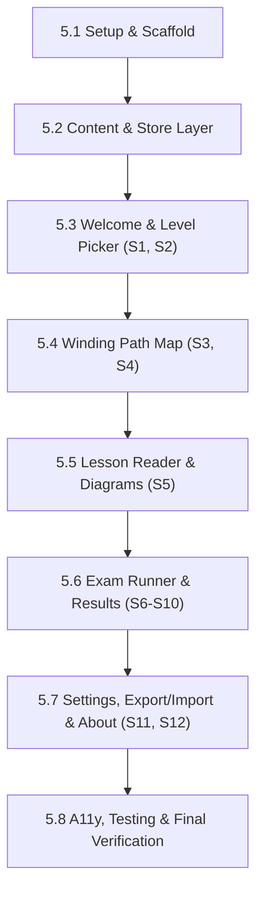

# Phase 5 Plan — Web App MVP

**Goal:** Build the working, production-ready web application MVP in Next.js 16 + TypeScript, implementing the screens and flows designed in Phase 3 (`docs/ux/flows.md`) and using the approved design system tokens (`config/brand.json`, `config/generated/tokens.css`). Connect the real curriculum content from `content/`, store progress in the browser with Zustand, test all product rules with Vitest, and verify accessibility with Playwright and axe-core.

Live status is in [PROGRESS.md](../PROGRESS.md).

---

## Technical Baseline & Standards

| Area | Choice | Specification |
|---|---|---|
| **Framework** | **Next.js 16 (App Router)** | TypeScript, Server Components by default, Turbopack |
| **Styling & Tokens** | **Tailwind CSS v4 + Base UI** | CSS variables linked from `config/generated/tokens.css` via `@theme` |
| **Lessons** | **MDX (`@next/mdx`)** | Compiled at build time; Server-side syntax highlighting via **Shiki** (`swift` grammar) |
| **Components** | **shadcn/ui** | Base UI primitives; accessible, keyboard-first, mobile-responsive |
| **Animation** | **Motion** | `motion/react` (client) and `motion/react-client` (server) |
| **Progress Storage** | **Zustand `persist`** | `localStorage`, versioned, sequential migration, `skipHydration: true` |
| **Unit Testing** | **Vitest** | 100% test coverage for product rules, scoring, and store migrations |
| **E2E & A11y Testing** | **Playwright + axe-core** | Responsive tests at 375px and desktop, zero WCAG A/AA contrast violations |

---

## Phase 5 Steps

### Step 5.1 — Setup & Scaffold
- Re-verify latest npm package versions for Next.js 16, Tailwind v4, Shiki, Motion, and Zustand.
- Scaffold Next.js 16 App Router application with TypeScript and Turbopack.
- Configure Tailwind CSS v4 to import our design tokens (`config/generated/tokens.css`, `config/brand.json`).
- Install official agent tools (`next-devtools-mcp`, Next.js dev loop skill, Vitest, Playwright, `@axe-core/playwright`).
- Preserve the managed Next.js agent block in `AGENTS.md`.

### Step 5.2 — Content & Store Layer
- Define Zod schemas matching `docs/curriculum-schema.md` for `levels.json`, `units.json`, `rules.json`, `topic.json`, and `questions.json`.
- Implement build-time content loaders and Server Component MDX compiler with Shiki syntax highlighting.
- Create the versioned Zustand progress store (`src/lib/store/progress.ts`):
  - Store learner level, passed topic IDs, best exam scores, topic versions, and skipped stages/units.
  - Add sequential migrations (`migrate(persistedState, version)`).
  - Implement `skipHydration: true` with client hydration listener to prevent SSR mismatch.
- Write Vitest unit tests verifying every product rule in `content/rules.json`:
  - 70% topic pass mark, 80% skip-test pass mark.
  - Topic score = best score; Progress = done / main; Path score = average of done main topics.
  - Locked stop calculation; bonus topics never block.
  - Store migration resilience: topic version bump, moved topic, retired topic, level change, corrupt JSON.

### Step 5.3 — Screen 1: Welcome & Level Picker (Screens S1, S2)
- Build **Welcome Screen (S1)**: First visit intro, 3-point value proposition, and "Choose my level" action.
- Build **Level Picker (S2)**: 5 level cards (Fresh $\rightarrow$ Staff) with summary, description, and interactive self-check checklist suggesting a level.
- Connect initial level selection to the progress store and route to the Path Map.

### Step 5.4 — Screen 2: Winding Path Map (Screens S3, S4)
- Build **Path Map Screen (S3)**:
  - Responsive zig-zag road with stage markers, unit signposts, and topic stop nodes.
  - 6 visual stop states: locked, current, passed, skipped, updated badge, bonus branch.
  - Top navigation bar: current level badge, progress percentage bar, and path score.
  - Stage/Unit skip test triggers for stages below current level.
  - Folding behavior for completed stages.
- Build **Locked Notice (S4)**: Bottom sheet / modal guiding the learner to the blocking prerequisite.

### Step 5.5 — Screen 3: Lesson Reader & Animated Diagrams (Screen S5)
- Build **Lesson Screen (S5)**:
  - Render MDX lesson content with section progression: InterviewHook, The simple idea, Diagram, Code with output, Traps, Interview answers, and Recap.
  - Embed interactive SVG diagrams with 4-step stepper controls and reduced-motion static fallback.
  - Normal / Large / Larger reading text size switcher.
  - Interactive, unscored QuickCheck cards with instant feedback.
  - "Updated" note banner if topic was revised after the learner passed.
  - Sources drawer and "Start Exam" action.

### Step 5.6 — Screen 4: Exam Runner & Results (Screens S6, S7, S8, S9, S10)
- Build **Exam Screen (S6)**:
  - 10-question drawing engine with answer option shuffling.
  - Immediate question feedback with Tap-then-Check workflow.
  - Browser grading for `mcq` and `code-reading` questions.
  - Rubric-based self-check for `written` and `code-write` questions.
- Build **Topic Result Screen (S7)**:
  - Score percentage, pass/fail badge (70% mark), question review list with mistake highlights.
  - Buttons: "Next Topic", "Retake Exam" (draws fresh questions), "Back to Lesson".
- Build **Skip Tests & Skip Results (S8, S9)**:
  - Stage and unit skip exams drawing questions across topics; 80% pass threshold.
  - Marks covered stops as skipped with the skip score.
- Build **Path Complete Screen (S10)**:
  - Overall path score percentage, stage/unit performance breakdown, strongest and weakest units, and next steps.

### Step 5.7 — Screen 5: Settings, Progress Export/Import & About (Screens S11, S12)
- Build **Progress & Settings Screen (S11)**:
  - Detailed progress breakdown per stage and unit.
  - Level switcher (preserves earned progress).
  - JSON file export, file import with schema preview validation, and reset with typed confirmation (`RESET`).
- Build **About Screen (S12)**:
  - Brand mission, source policies, and privacy guarantee (all progress stored on device).

### Step 5.8 — Accessibility, Testing & Final Verification
- Run Vitest suite: 100% pass across all product rule tests.
- Run Playwright E2E test suite across all 8 user flows (`docs/ux/flows.md`) at 375px mobile and desktop width.
- Run automated `axe-core` accessibility audit across all screens (0 WCAG A/AA violations).
- Verify keyboard focus order, active focus rings, and screen-reader announcements.
- Perform the human VoiceOver test flow and measure real lesson reading time.
- Verify production build (`next build`) and Turbopack output.
- Update `PROGRESS.md`, author `docs/phase-5-summary.md`, and commit to Git.

---

## Deliverables for Phase 5 Approval

1. **Scaffolded, running Next.js 16 Web App** with zero console errors.
2. **All 12 Screens and 8 Flows** fully playable in light and dark mode.
3. **100% passing Vitest test suite** for product rules and store migrations.
4. **100% passing Playwright & axe-core test suite** at 375px and desktop.
5. **Phase 5 Summary document** ([`docs/phase-5-summary.md`](phase-5-summary.md)) and clean Git commits.
