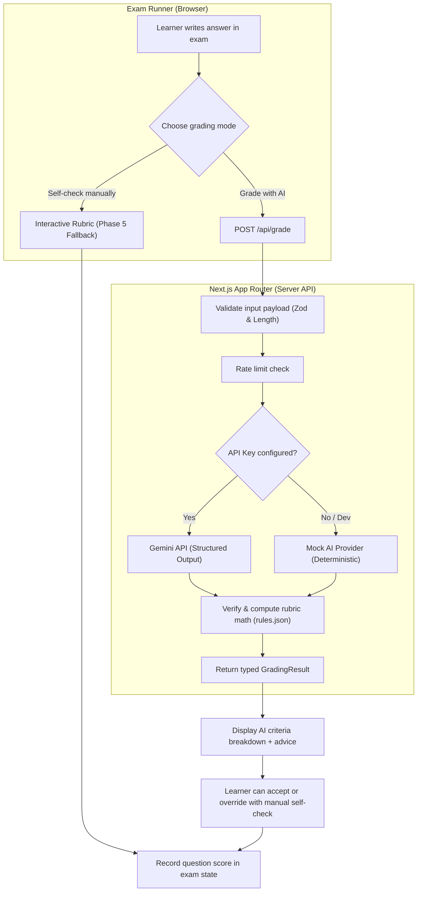
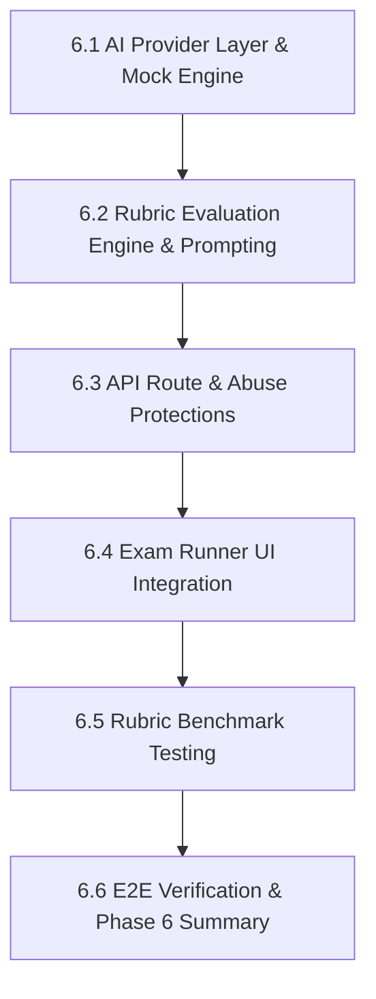

# Phase 6 Plan — AI Grading

**Goal:** Integrate automated AI evaluation into the exam runner for written (`written`) and code-write (`code-write`) questions using the Google Gemini API (free tier), strictly adhering to curriculum rubrics and scoring rules (`content/rules.json`). Implement rate limiting, payload protection, graceful fallback to manual self-check, and automated evaluation tests against our 24-sample rubric benchmark test files.

Live status is tracked in [PROGRESS.md](../PROGRESS.md).

---

## Technical Baseline & Rules

| Area | Choice | Specification |
|---|---|---|
| **Primary AI Provider** | **Google Gemini API** | `gemini-2.5-flash` (or `gemini-2.5-flash-lite`), free tier |
| **Provider Abstraction** | `src/lib/ai/provider.ts` | Clean interface allowing swap between Gemini, Cloudflare Workers AI fallback, and deterministic Mock |
| **Output Format** | **Structured JSON via Zod** | Strongly-typed schema returning per-criterion status (`met`, `partlyMet`, `notMet`), score, and feedback |
| **Scoring Rules** | `content/rules.json` | Met = 100%, Partly met = 50%, Not met = 0%; missed key criterion (`key: true`) caps score at 50% max |
| **Pass Mark** | `content/rules.json` | 70% topic pass mark; 80% skip-test pass mark |
| **Privacy Guarantee** | **Zero Personal Data** | Only question prompt, rubric criteria, and learner's answer are sent; no cookies, names, or emails |
| **Abuse & Rate Limits** | **Client & Server Guard** | Max 2,000 characters per answer; rate-limiting per minute; timeout handling (8s) |
| **Offline / Error Fallback**| **Interactive Self-Check** | If offline, rate-limited, or API key absent, seamlessly fall back to the existing manual rubric self-check |

---

## Architecture & Data Flow

---

## Phase 6 Steps

### Step 6.1 — AI Provider Layer & Mock Engine
- Define `GradingProvider` interface in `src/lib/ai/provider.ts`.
- Implement `MockGradingProvider` in `src/lib/ai/mock.ts` that deterministically parses rubrics for unit testing, CI, and local development without requiring external API keys.
- Implement `GeminiGradingProvider` in `src/lib/ai/gemini.ts` using the official Google Gen AI SDK (`@google/genai`) or direct HTTP fetch with structured output schemas.
- Provide environment variable configuration (`GEMINI_API_KEY`) and fallback resolution.

### Step 6.2 — Rubric Evaluation Engine & Prompting
- Define strongly typed evaluation input and output schemas in `src/lib/ai/schema.ts`:
  - `GradingRequest`: `questionId`, `questionType`, `prompt`, `rubric`, `learnerAnswer`, `modelAnswer` (optional).
  - `GradingResponse`: `criteriaResults: [{ id, status, feedback }]`, `score`, `keyCriterionMet`, `summaryAdvice`.
- Author system prompt following CEFR B1 Plain English:
  - Friendly, encouraging coach voice.
  - Strict adherence to rubric criteria; no hallucinations.
  - Clear explanations of *why* a criterion was marked met, partly met, or not met.
- Enforce rubric calculation rules in pure TypeScript (`src/lib/curriculum/scoring.ts`):
  - Met: 100% of weight.
  - Partly met: 50% of weight.
  - Not met: 0% weight.
  - If any criterion with `key: true` is not met, the final question score is capped at 50% max.

### Step 6.3 — API Route & Abuse Protections
- Build Next.js App Router API route `POST /api/grade` (`src/app/api/grade/route.ts`).
- Add abuse protection:
  - Payload length limits (learner answer strictly bounded to 2,000 characters).
  - Request body validation via Zod.
  - In-memory rate limiting (max 10 grading requests per minute per IP).
  - Request timeout guard (8 seconds) returning structured error.
- Privacy guarantee: No personal identifiers, cookies, or user tracking metadata passed to the AI provider.

### Step 6.4 — Exam Runner UI Integration
- Update written and code-write question components in `src/components/exam/`:
  - Add **"Grade with AI"** button alongside **"Self-check manually"**.
  - Animated loading state with calming indicator.
  - Results display:
    - Overall score badge and key criterion status.
    - Per-criterion checklist (green check for met, amber minus for partly met, gray cross for not met) with short constructive feedback.
    - Quick "Override with manual check" toggle if learner feels AI missed nuance.
  - Offline / error state: If network is offline, rate limit exceeded, or API fails, automatically reveal the interactive self-check rubric with a friendly alert banner.

### Step 6.5 — Rubric Benchmark Testing
- Write automated Vitest evaluation test suite (`src/lib/ai/__tests__/benchmark.test.ts`).
- Benchmark against the curated Good, Average, and Weak sample answers documented in `docs/topics/*/rubric-test.md`:
  - Good answers should consistently score $\ge$ 70%.
  - Weak answers should consistently score $<$ 50%.
  - Answers missing the key criterion must be capped at $\le$ 50%.

### Step 6.6 — E2E Verification & Phase 6 Summary
- Add Playwright E2E test verifying AI grading flow in the exam runner (using mock provider).
- Run axe-core accessibility audit on the updated exam screens.
- Build Next.js production bundle with Turbopack and verify 0 regressions.
- Author `docs/phase-6-summary.md` and update `PROGRESS.md`.
