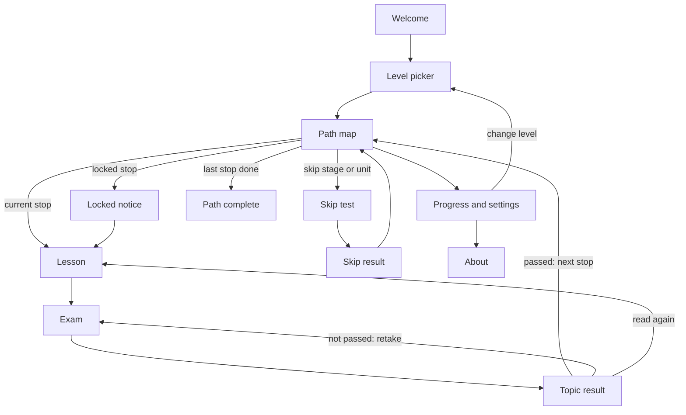

# Screens and Flows (Step 3.1)

Decided 2026-10-23. Visual version: the Flow Map page (link in [PROGRESS.md](../../PROGRESS.md)).

## Decisions (from the user)

| Question | Decision |
|---|---|
| Skipped topics in the total percentage | **They count with the skip-test score.** For example, 85% on a skip test means each skipped topic counts as 85% |
| Shuffle answer options | **Yes, every time** the exam is shown |
| A passed topic gets updated | **"Updated" badge on the path + a note in the lesson. The pass is kept.** Taking the exam again is optional |
| Locked topics | **Fully locked.** A locked topic cannot be opened until the topic before it is passed (or skipped) |
| Changing level | **Any time, progress kept.** Topics are shared between levels, so passed topics stay passed |
| First visit | **A short welcome, then the level picker** |

## Words and numbers

- **Topic score** = the learner's best exam score for that topic (0–100%). Pass at 70%.
  - Browser-graded questions score 0 or 100.
  - AI-graded questions use their rubric score. Until AI grading exists (Phase 6), they use the self-check and do not count.
- **Skipped topic** = a topic covered by a passed skip test (80%). Its topic score is the skip-test score.
- **Progress** = done topics ÷ main topics on the path. "Done" means passed or skipped.
- **Path score** = the average topic score of all **done** main topics. When the path is complete, this is the **total result** and percentage the learner sees at the end.
- **Bonus topics** count in neither number.
- **Skip tests** exist only for stages **below** the learner's level, because the product rule is to skip *earlier-level* topics. A senior can skip the fresh, junior and mid stages, or single units inside them.

## Screens

| ID | Screen | What it does |
|---|---|---|
| S1 | **Welcome** | First visit only. What the app is (3 lines), how a topic works (lesson → exam → next stop), and a "Choose my level" button |
| S2 | **Level picker** | 5 level cards, each with its summary, description and "You are here if you can…" self-check. Also opened from Settings to change level |
| S3 | **Path map** | The winding road for the chosen level. Stage signs, unit labels, topic stops, bonus side roads. Top bar: level, progress %, path score. Stage signs and unit labels below the learner's level have "Skip" buttons |
| S4 | **Locked notice** | A small sheet: "Pass *Topic X* first." It has a button to go to that topic |
| S5 | **Lesson** | The lesson in the agreed format. Shows the "Updated" note if the topic changed after the learner passed it. Ends with "Start the exam" |
| S6 | **Exam** | 10 questions with shuffled options, and feedback right after each question |
| S7 | **Topic result** | Score, pass or not, a review of every question, and the best score. Buttons: next topic, retake (new questions), back to the lesson |
| S8 | **Skip test** | Like the exam, with questions from every topic of the stage or unit (sizes in `rules.json`) |
| S9 | **Skip result** | Pass at 80% marks the topics as skipped, with the score. If it fails, nothing changes, and the learner can try again or take the topics normally |
| S10 | **Path complete** | The total result: path score %, a breakdown per stage and unit, the strongest and weakest units, and what to do next (bonus topics, a higher level) |
| S11 | **Progress and settings** | Progress per stage and unit, change level, export progress to a file, import a file, reset progress |
| S12 | **About** | What the app is, where the content comes from (sources policy), privacy (progress stays in the browser) |
| — | **States** | Empty (no progress yet), loading, "storage is blocked" (progress cannot be saved: export is offered), file import error, page not found |

## Flows

### F1 — First visit
S1 Welcome → S2 Level picker → S3 Path map. If the level is above fresh, the path shows a short tip: "Already know the basics? Skip a stage with a short test."

### F2 — Learn one topic (the main loop)
S3 Path map → tap the current stop → S5 Lesson → S6 Exam → S7 Topic result.
- **Passed:** the next stop unlocks, and a short celebration plays on the path. Then "Next topic" or back to the path.
- **Not passed:** retake with new questions, or read the lesson again.
- **Locked stop:** S4 Locked notice.

### F3 — Skip earlier topics
S3 Path map → "Skip this stage" or "Skip this unit" → S8 Skip test → S9 Skip result.
- **Passed (80%):** those stops show "Skipped" with the score.
- **Not passed:** no change.

### F4 — Finish the path
The last main stop is done → S10 Path complete. The total result is also visible at any time in S11 and on the path's top bar.

### F5 — A topic is updated
The learner passed the topic → the content gets a new version → the stop shows an "Updated" badge → S5 shows "Updated on (date): (note)" → an optional "Take the exam again". The best score is kept.

### F6 — Change level
S11 → S2 → S3 for the new level. Passed and skipped topics stay done. A higher level adds stages; a lower level hides them, but their results are kept.

### F7 — Keep progress safe
Progress is saved in the browser automatically. S11 offers "Export progress" (a file) and "Import progress". This lets people move to another browser before login exists.

### F8 — Bonus topics
A bonus stop opens when its main topic is passed. It has its own lesson and exam, but it does not change progress or the path score.

## Flow diagram

